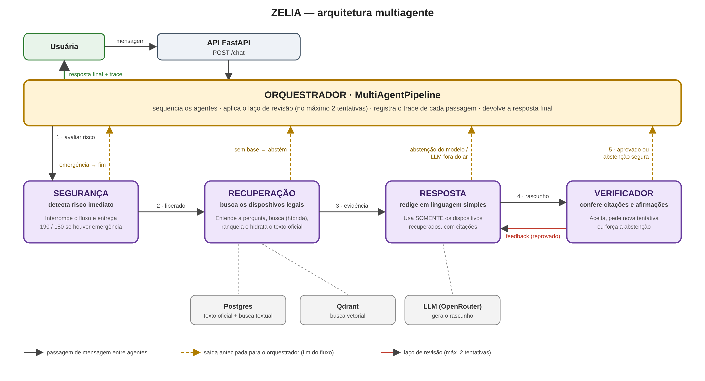
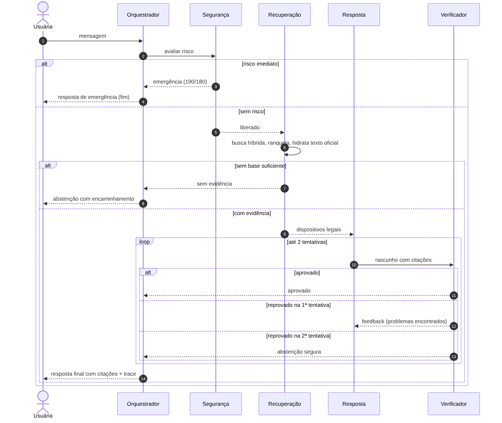

# 12 — Arquitetura multiagente (Semana 4)

**Status:** protótipo funcional · 2026-11-16
**Código:** [`src/agents/`](../src/agents/) · **Testes:** `tests/unit/test_agents.py` · **Demo:** `scripts/demo_multiagente.py`

Este documento descreve o primeiro sistema multiagente do ZELIA: quais agentes existem,
o que cada um faz (e o que **não** faz), como eles colaboram e como demonstrar o fluxo.

---

## 1. Ideia central

O pipeline RAG da Semana 3 já tinha etapas bem separadas (risco, recuperação, geração,
verificação), mas executadas por uma única classe. Na Semana 4 cada etapa passou a ser um
**agente com uma responsabilidade única**, e um **orquestrador** decide quem age em
seguida, repassa os resultados entre eles e registra cada passagem (o *trace*).

Duas decisões de projeto importam:

1. **Colaboração, não só divisão de código.** Os agentes se comunicam por mensagens
   tipadas (`AgentMessage`). O Verificador pode *devolver* o rascunho ao agente de
   Resposta com feedback; o agente de Segurança pode *interromper* o fluxo inteiro.
2. **Mesmo comportamento, mais transparência.** A resposta final é **idêntica** à do
   pipeline anterior (comprovado por teste de equivalência em 9 cenários). O que muda é
   que agora dá para ver quem decidiu o quê.



---

## 2. Os agentes e suas responsabilidades

| Agente | Responsabilidade (única) | Recebe | Entrega | Não faz |
|---|---|---|---|---|
| **Segurança** (`SafetyAgent`) | Detectar risco imediato. Se houver, interrompe o fluxo e entrega a resposta de emergência (190/180). | mensagem | `risco` (liberado) ou `emergencia` | Não busca nem gera texto jurídico |
| **Recuperação** (`RetrievalAgent`) | Entender a pergunta, buscar dispositivos legais (híbrida), ranquear, deduplicar por artigo e hidratar o texto oficial. | mensagem + fatos | `evidencia` ou `sem_evidencia` (com o motivo) | Não redige resposta |
| **Resposta** (`AnswerAgent`) | Redigir em linguagem simples usando **somente** os dispositivos recuperados, com citações. Refaz quando recebe feedback. | dispositivos (+ feedback) | `rascunho` ou `rascunho_rejeitado` | Não decide se o próprio rascunho é bom |
| **Verificador** (`VerifierAgent`) | Conferir se cada citação existe no contexto, se a versão é a vigente e se as afirmações são sustentadas. Decide: aceitar, pedir nova tentativa ou abster. | rascunho + dispositivos | `veredito` (`accept` / `regenerate` / `abstain`) | Não escreve a resposta |
| **Orquestrador** (`MultiAgentPipeline`) | Sequenciar os agentes, aplicar o limite de 2 tentativas, escolher o fallback seguro e registrar o trace. | — | resposta final + trace | Não tem regra jurídica própria |

A separação **Resposta × Verificador** é o ponto central da colaboração: quem escreve não
é quem aprova. Isso reduz o risco de a resposta citar um dispositivo que não foi
recuperado ou afirmar algo que a lei não diz.

> **Próximo agente (Semana 5):** o **Agente de Serviços** (delegacias mais próximas) entra
> no mesmo desenho, acionado pelo orquestrador quando a pergunta for "onde pedir ajuda".

---

## 3. Fluxo de interação



Passo a passo (cada linha vira um passo do `trace`):

1. A usuária envia a mensagem; o orquestrador a entrega ao **Segurança**.
2. **Risco imediato** → o Segurança responde `emergencia`; o orquestrador devolve a
   resposta de emergência e **nenhum outro agente roda** (nem banco, nem LLM).
3. **Sem risco** → o Segurança libera; o **Recuperação** busca os dispositivos.
4. **Sem base suficiente** → o Recuperação responde `sem_evidencia`; o orquestrador devolve
   abstenção com encaminhamento (Defensoria Pública, 180, DEAM).
5. **Com evidência** → o **Resposta** redige um rascunho com citações e o envia ao
   **Verificador**.
6. **Aprovado** → o orquestrador entrega a resposta final.
7. **Reprovado na 1ª tentativa** → o Verificador devolve o rascunho ao Resposta **com o
   feedback** dos problemas encontrados, e o Resposta tenta de novo.
8. **Reprovado na 2ª tentativa** → abstenção segura (mostra só os dispositivos
   recuperados, sem afirmar nada além deles).

Saídas seguras adicionais: LLM indisponível → resposta extrativa com o texto literal da
lei; saída do LLM inválida duas vezes → mesma resposta extrativa.

---

## 4. Contrato de mensagens

```python
@dataclass(frozen=True)
class AgentMessage:
    sender: str        # agente que enviou ("seguranca", "recuperacao", ...)
    recipient: str     # próximo agente ou "orquestrador"
    kind: str          # risco | emergencia | evidencia | sem_evidencia |
                       # rascunho | rascunho_rejeitado | veredito | resposta_final
    decision: str      # resumo curto, sem texto da usuária
    payload: Mapping   # objetos tipados que o destinatário precisa
    trace_id: str
```

O **trace** é a lista dessas passagens, com o tempo de cada uma. Ele **nunca contém o texto
da usuária** (há teste para isso): só agente, destino, tipo, decisão e milissegundos.

### Ver o trace pela API

`POST /chat` aceita `"trace": true` e devolve o campo `trace`:

```json
{
  "session_id": "demo",
  "message": "O que diz o art. 7º da Lei Maria da Penha?",
  "trace": true
}
```

```json
"trace": [
  {"agent": "seguranca",   "to": "recuperacao",  "kind": "risco",          "decision": "sem risco imediato: segue para recuperação", "elapsed_ms": 0.1},
  {"agent": "recuperacao", "to": "resposta",     "kind": "evidencia",      "decision": "1 dispositivo(s) por citação explícita",    "elapsed_ms": 2.0},
  {"agent": "resposta",    "to": "verificador",  "kind": "rascunho",       "decision": "rascunho 1 com 1 citação(ões)",             "elapsed_ms": 2.1},
  {"agent": "verificador", "to": "orquestrador", "kind": "veredito",       "decision": "aprovado (1/1 afirmações sustentadas)",     "elapsed_ms": 0.3},
  {"agent": "orquestrador","to": "usuaria",      "kind": "resposta_final", "decision": "resposta entregue com 1 citação(ões)",      "elapsed_ms": 0.0}
]
```

Sem `"trace": true` o campo vem `null` e a resposta é a mesma de antes. A variável de
ambiente `MULTIAGENT=false` desliga a camada de agentes e volta ao pipeline direto.

---

## 5. Demonstração (fluxo completo com agentes colaborando)

```bash
# Modo offline (padrão): dados e LLM simulados; roda em qualquer computador
uv run python scripts/demo_multiagente.py

# Modo real: Postgres + Qdrant + LLM do .env (docker compose up -d antes)
uv run python scripts/demo_multiagente.py --real
```

Três cenários:

| # | Cenário | O que mostra |
|---|---|---|
| 1 | Pergunta jurídica comum | Os 4 agentes em sequência; Verificador aprova; resposta com citação |
| 2 | Emergência | Só o Segurança atua e interrompe; 190/180; nenhuma busca nem LLM |
| 3 | Fora do corpus | Recuperação não acha base e o fluxo termina em abstenção com encaminhamento |

O modo offline usa um artigo simulado apenas para ensaio; para a gravação final, use o
modo real, em que o texto vem do banco com a legislação oficial.

---

## 6. Como foi validado

- `tests/unit/test_agents.py` — 18 testes:
  - **equivalência**: para 9 cenários (aceita de primeira, abstenção do modelo, JSON
    inválido e refaz, JSON inválido duas vezes, citação fora do contexto, LLM fora do ar,
    Verificador reprova duas vezes, sem recuperação, emergência), o resultado do orquestrador
    é igual ao do pipeline anterior (resposta, citações, abstenção, ids, afirmações);
  - **colaboração**: ordem dos agentes no trace, interrupção por emergência, feedback do
    Verificador devolvido ao agente de Resposta, máximo de 2 tentativas;
  - **privacidade**: o trace não contém o texto da usuária;
  - **API**: `trace` só aparece quando solicitado, inclusive no caminho de emergência.
- A suíte existente continua verde (nenhuma regressão).

## 7. Limitações conhecidas

- A recuperação ainda é uma etapa única; ela poderia ser dividida em "entender a pergunta"
  e "buscar", se a demanda por transparência aumentar.
- Os agentes rodam em sequência no mesmo processo (não são serviços separados); isso é
  suficiente para o protótipo e simplifica a demonstração.
- A latência do LLM no ambiente de teste foi alta nos benchmarks da Semana 3; ela não
  muda com a camada de agentes (o custo extra do orquestrador é de milissegundos).
- Os agentes de Serviços (mapa de delegacias), Voz e Canal com a polícia ainda não
  existem; estão planejados para as Semanas 5 e 6.
