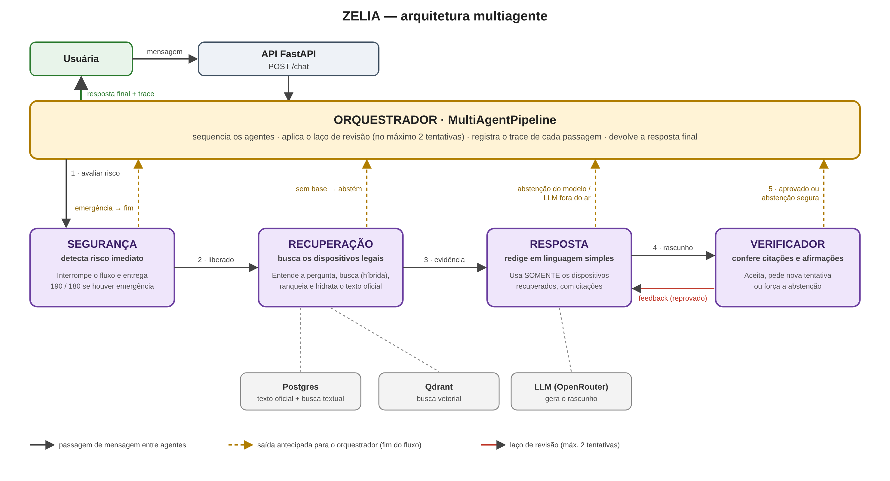
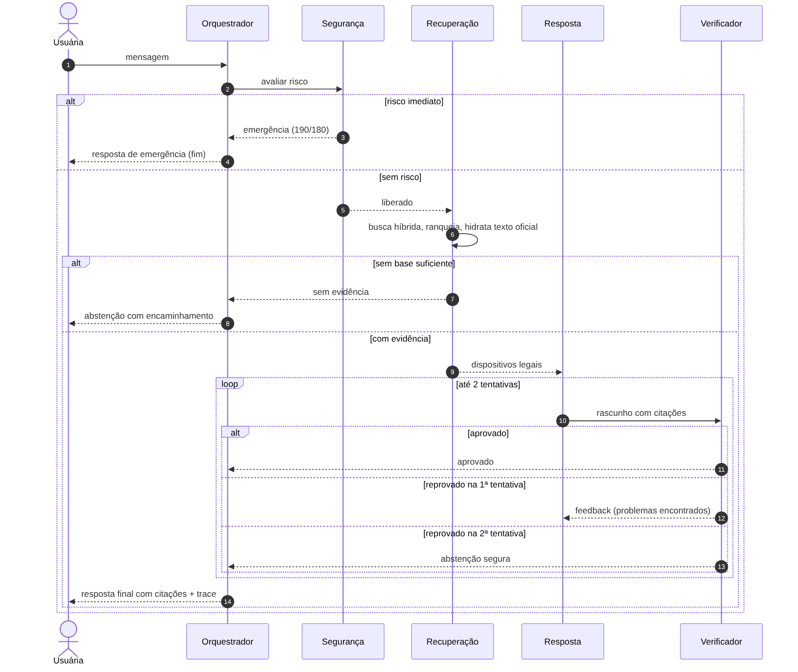

# Zelia — protótipo multiagente

**Entrega:** RES-IA Challenge 2 · assistente jurídica para mulheres em situação de violência doméstica
**Data do registro:** 2026-11-18 · **commit base:** `76da02c` (main) · **branch da documentação:** `fix/citacao-fantasma`
**Natureza:** relatório técnico do protótipo. Não substitui revisão jurídica nem parecer de advogada(o).

---

## 1. Introdução

A **Zelia** é uma assistente jurídica conversacional para mulheres em situação de violência doméstica.
Ela explica direitos, prazos e caminhos a partir da Lei Maria da Penha, do Código Penal e das
súmulas do STJ — e só afirma o que consegue apontar num dispositivo legal ingerido.

O problema que justifica o cuidado é simples de enunciar: uma pessoa em situação de risco vai fazer
perguntas concretas ("posso pedir que ele saia de casa?", "em quanto tempo o juiz decide?") e não tem
como distinguir uma resposta correta de uma resposta plausível. Um modelo de linguagem, sozinho, produz
as duas com a mesma segurança. Por isso o protótipo foi construído em torno de uma regra: **a afirmação
jurídica só é publicada se estiver ancorada num dispositivo recuperado e verificado** — e quando não
estiver, o sistema prefere dizer que não sabe.

Este documento registra a implementação do sistema **multiagente** que operacionaliza essa regra: quatro
agentes com responsabilidade única, um orquestrador que costura o fluxo e registra cada passagem, e um
runtime durável que executa a resposta fora do pedido HTTP. A colaboração entre agentes é o assunto
central — não a sofisticação do modelo.

## 2. Objetivo do Sistema Multiagente

O objetivo é transformar uma pergunta em **uma resposta verificável, ou numa recusa honesta**, com o
mínimo de decisões entregue ao modelo.

A arquitetura multiagente resolve três problemas concretos que um único prompt não resolve:

1. **Política não pode depender do humor do modelo.** Se a mensagem indica perigo imediato, a resposta
   de emergência sai antes de qualquer chamada de rede, de banco ou de modelo. Quem decide isso é código
   determinístico (`src/safety/risk.py`), não o LLM.
2. **Quem escreve não pode ser quem aprova.** O agente de resposta redige; o verificador confere cada
   citação contra o dispositivo hidratado e cada afirmação contra o texto literal. A separação é o que
   torna a conferência independente.
3. **Abstenção precisa ser uma saída legítima, não um erro.** Sem base suficiente, com citação que não
   existe ou com o modelo fora do ar, o sistema entrega uma recusa segura — com os dispositivos que
   encontrou, sem inventar o que não encontrou.

O que a arquitetura **não** pretende: dar veredito sobre o caso, prometer resultado, substituir a
Defensoria Pública. Ela explica direitos e encaminha para atendimento humano.

## 3. Arquitetura do Sistema

### 3.1. Visão geral da arquitetura

O fluxo tem quatro agentes e um orquestrador. Toda comunicação entre agentes passa por objetos
`AgentMessage` entregues pelo orquestrador, e cada entrega é registrada num `Trace` que acompanha a
resposta até a usuária — sem nunca guardar o texto do relato.



Duas camadas precisam ser distinguidas:

- **Camada de colaboração** (`src/agents/orchestrator.py`): os quatro agentes em sequência, com laço de
  revisão de no máximo duas tentativas. É o caminho usado por `POST /chat` e o que produz o `trace`.
- **Camada de execução durável** (`src/agents/graph.py`, `src/worker.py`): a mesma política expressa como
  grafo LangGraph (`decidir → pesquisar → sintetizar → validar`) executado por um worker que reivindica
  execuções no banco. É o que permite fechar a aba do navegador e recuperar a resposta depois.

No grafo, apenas `decidir`, `pesquisar` e `sintetizar` tocam o modelo (e `decidir` é classificação
determinística, sem custo). Orçamento, roteamento, detecção de evidência insuficiente e o gate de
publicação são determinísticos — o grafo é testável sem LLM, sem rede e sem banco.

Na base ficam três dependências, e a separação é intencional: **PostgreSQL** guarda o texto oficial, as
versões e a busca lexical; o índice vetorial guarda o caminho denso (pgvector no caminho padrão, Qdrant
no caminho-alvo); o **OpenRouter** serve o modelo de linguagem. Se o modelo cai, a recuperação continua
funcionando e a resposta degrada para abstenção segura.

### 3.2. Tecnologias utilizadas

| Camada | Tecnologia | Papel no protótipo |
| --- | --- | --- |
| Linguagem e empacotamento | Python 3.12, `uv` | Base do serviço, das migrações e dos scripts |
| API | FastAPI + Uvicorn | `POST /chat`, rotas v1 de conversa e execução, `/health` |
| Contratos | Pydantic v2 (`extra="forbid"`) | Schema de entrada, saída do modelo e mensagens entre agentes |
| Orquestração de agentes | LangGraph (grafo) + orquestrador sequencial | Política, roteamento, laço de revisão |
| Banco | PostgreSQL 17 + `pgvector` | Texto literal, versões, busca lexical (`tsvector`) e densa |
| Índice vetorial alternativo | Qdrant | Caminho-alvo com multivector/MaxSim |
| Persistência | `psycopg` 3, migrações SQL `001`–`006` | Registro de execuções, idempotência, retenção |
| Modelo de chat | `qwen/qwen3.7-flash` via OpenRouter | Redação do rascunho a partir dos dispositivos |
| Embeddings | `qwen/qwen3-embedding-8b` (1024 dimensões) | Indexação e consulta (base: 10.797 vetores) |
| Pesquisa web (opcional) | SerpApi `google_light` | Evidência externa quando habilitada (ADR-09) |
| Qualidade | pytest, `ruff`, `mypy`, Node test runner | 1085 testes de unidade, 75 de integração, 7 de JS |
| Infra local | Docker Compose | Postgres/pgvector, Qdrant e volumes de dados |
| CI/CD | GitHub Actions (`ci.yml`, `pages.yml`) | 5 jobs: lint, typecheck, test, integration, backup-restore |
| Marca e interface | Kit v1.0 "Percurso + Azul Pulso", HTML/CSS/JS | UI do chat, site da entrega e design system |

## 4. Definição dos Agentes

Cada agente tem uma responsabilidade, um formato de entrada e um formato de saída. Nenhum deles
conversa com outro diretamente: todo repasse é um `AgentMessage` que o orquestrador entrega e registra.

### 4.1. Agente de Segurança (`seguranca`)

**Objetivo.** Reconhecer risco imediato e interromper o fluxo antes de qualquer outra etapa.

**Responsabilidades.** Classificar a mensagem por marcadores explícitos de agressão, ameaça e risco de
vida; em caso positivo, devolver a resposta de emergência com os canais 190/180/100/197; em caso
negativo, liberar a recuperação.

**Dados de entrada.** O texto da mensagem. Nada mais — o agente não acessa banco, índice nem modelo.

**Resultado produzido.** `AgentMessage(kind="emergencia")` quando há risco, com a resposta pronta no
payload, ou `AgentMessage(kind="risco")` liberando o próximo agente. Custo observado: **0,19 ms** — o
caminho de emergência não faz I/O.

### 4.2. Agente de Recuperação (`recuperacao`)

**Objetivo.** Encontrar os dispositivos legais que devem fundamentar a resposta — e dizer quando não há
base suficiente.

**Responsabilidades.** Interpretar a pergunta, expandir vocabulário jurídico, buscar por duas vias
(densa e lexical), fundir e ranquear, deduplicar por artigo, hidratar o texto oficial da versão vigente
e devolver as evidências tipadas. Se o resultado vier vazio ou ambíguo, devolve o motivo da abstenção
em vez de devolver "algo parecido".

**Dados de entrada.** Mensagem e fatos da consulta (data do fato, por exemplo).

**Resultado produzido.** `AgentMessage(kind="evidencia")` com a lista de dispositivos hidratados
(`device_id` + `norm_version_id` + texto literal + citação canônica) ou `kind="sem_evidencia"` com
`abstain_reason`. Tempo observado na demonstração: **4,4 s** para 9 dispositivos.

### 4.3. Agente de Resposta (`resposta`)

**Objetivo.** Redigir, em linguagem simples, uma resposta que use **somente** os dispositivos recuperados.

**Responsabilidades.** Montar o prompt com contexto, pergunta e subperguntas; pedir a saída estruturada
ao modelo (JSON com resposta, citações por `device_id`, próximos passos, encaminhamentos, nível de
confiança); validar o formato; e refazer a redação quando o verificador devolve problemas.

**Dados de entrada.** Pergunta, dispositivos recuperados e, na segunda tentativa, o feedback do
verificador.

**Resultado produzido.** `AgentMessage(kind="rascunho")` com um `Draft` — `status` em `ok`, `abstencao`,
`llm_indisponivel`, `saida_invalida`, `citacao_invalida` ou `erro`. Em falha, informa o motivo tipado;
nunca devolve texto parcial.

### 4.4. Agente Verificador (`verificador`)

**Objetivo.** Conferir o rascunho de forma independente e decidir se ele pode ser publicado.

**Responsabilidades.** Verificar se cada citação existe no conjunto recuperado, se aponta para a versão
vigente e se o texto da citação corresponde ao metadado hidratado; verificar se cada afirmação jurídica
tem citação; *não* aceitar afirmação genérica sustentando afirmação específica ("o artigo prevê medidas"
não sustenta "o juiz decide em 48 horas").

**Dados de entrada.** Rascunho do modelo e os dispositivos recuperados.

**Resultado produzido.** `AgentMessage(kind="veredito")` com um `Verdict` — `accept`, `regenerate` (com
lista de problemas), `abstain` ou `error` — mais quais afirmações foram sustentadas.

> **Sobre o orquestrador.** Não é um quinto agente "inteligente": é o componente que sequencia, aplica o
> limite de duas tentativas, garante que nenhum agente veja mensagem que não deveria ver e registra cada
> passagem no `Trace`. Ele também é quem transforma "verificador não aprovou" em abstenção — não existe
> caminho em que um rascunho reprovado chegue à usuária.

> **Serviço complementar, fora do grafo de agentes.** Além dos quatro agentes, o protótipo responde
> "onde pedir ajuda": `POST /services/nearby` recebe coordenada (arredondada a ~110 m) ou município/UF e
> devolve a DEAM, o núcleo de atendimento à mulher ou a delegacia comum mais próxima. A localização é
> usada só naquela requisição — não é armazenada nem registrada em log, apenas a contagem de resultados.
> Ele é **serviço, não agente**: não participa do fluxo da pergunta jurídica. Entrar no desenho como
> agente, acionado pelo orquestrador, é o próximo passo natural.

## 5. Fluxo de Interação entre os Agentes



Passo a passo do que acontece numa pergunta comum:

1. **A usuária envia a mensagem.** `POST /chat` valida o contrato (`session_id` obrigatório, campo
   desconhecido é erro) e chama o orquestrador.
2. **Segurança avalia o risco.** Se há risco imediato, o orquestrador encerra aqui e devolve a resposta
   de emergência — sem banco, sem índice, sem modelo. Se não há, a mensagem segue.
3. **Recuperação busca a base.** Consulta densa e lexical em paralelo, fusão por RRF, deduplicação por
   artigo, hidratação do texto oficial. Sem resultado utilizável, o orquestrador encerra com abstenção
   e encaminhamento.
4. **Recuperação entrega a evidência.** O que passa adiante são dispositivos com identidade estável
   (`lmp/art18/cpt/inc1`) e a versão exata do texto — não trechos soltos de texto.
5. **Resposta redige.** Recebe a evidência, monta o prompt e pede a saída estruturada ao modelo.
6. **Verificador confere.** Cada citação é confrontada com o conjunto recuperado; cada afirmação, com o
   texto literal. Aprovado, vai adiante.
7. **Reprovado na primeira tentativa.** O verificador devolve os problemas encontrados e a resposta é
   refeita **uma** vez, já com o feedback no prompt.
8. **Reprovado na segunda tentativa.** O fluxo termina em abstenção segura — nunca em publicação parcial.
9. **Modelo fora do ar.** O rascunho volta como `llm_indisponivel` e o sistema entrega a resposta segura
   com os dispositivos recuperados, deixando claro que não conseguiu gerar a explicação.
10. **O orquestrador fecha o trace.** Cada passagem registra agente, destinatário, tipo de mensagem,
    decisão em texto curto e tempo decorrido. O trace acompanha a resposta e não contém o relato da pessoa.

**O fluxo durável, para o mesmo conteúdo.** Quando a execução é aceita pela API v1, ela entra como
`pending` no registro de execuções e o cliente recebe um `run_id` imediatamente. O worker reivindica a
execução com `FOR UPDATE SKIP LOCKED`, aplica um lease com `attempt` (fencing) e executa a resposta fora
de transação; a publicação abre outra transação e é idempotente, de modo que um worker que perdeu o lease
não publica por cima do vigente. O cliente acompanha por revisão e recupera o resultado depois — inclusive
com a aba fechada.

## 6. Demonstração do Protótipo

### 6.1. Cenário de teste

Três casos, escolhidos para exercitar caminhos diferentes do mesmo fluxo:

| # | Caso | Pergunta | Caminho esperado |
| --- | --- | --- | --- |
| 1 | Risco imediato | "me empurrou e ameaçou me bater" | Interrupção em Segurança |
| 2 | Dúvida jurídica com resposta na base | "Quais medidas protetivas posso pedir ao juiz e em quanto tempo elas saem?" | Recuperação → Resposta → Verificador aprovando |
| 3 | Mesma dúvida, com o provedor indisponível | idem | Abstenção segura, sem invenção |

O caso 2 foi executado em 2026-11-16 sobre a base real, com o processo da API (`create_app` + `TestClient`).
Os casos 1 e 3 foram executados em 2026-11-18, diretamente pelo orquestrador de agentes, e são os que
aparecem com trace completo abaixo.

### 6.2. Execução dos agentes

**Caso 1 — risco imediato.** A Segurança reconhece agressão e o fluxo termina ali:

```text
seguranca -> orquestrador   [emergencia]   risco imediato (agressao): fluxo interrompido   0,19 ms
```

Nenhuma busca, nenhuma conexão, nenhuma chamada de modelo. É a política INV09 operando: emergência
antes de I/O.

**Caso 3 — modelo indisponível no meio do caminho.** O trace mostra a recuperação funcionando e a
geração falhando com tipo:

```text
seguranca   -> recuperacao    [risco]              sem risco imediato: segue para recuperação     0,08 ms
recuperacao -> resposta       [evidencia]          9 dispositivo(s) por busca                 4.370,69 ms
resposta    -> orquestrador   [rascunho_rejeitado] tentativa 1: llm_indisponivel              39.496,36 ms
orquestrador-> usuaria        [resposta_final]     abstenção: llm_indisponivel                  46,14 ms
```

O dado relevante não é a falha: é **o que o sistema faz com ela**. A tentativa esgota as retentativas do
cliente, o rascunho volta tipado como `llm_indisponivel`, e o orquestrador entrega a resposta segura com
os dispositivos que a recuperação tinha em mãos. Nada é inventado para preencher a lacuna.

**Caso 2 — dúvida jurídica com base.** Execução de 2026-11-16, com `abstencao=false` e
`nivel_confianca=medio`: o rascunho passou pelo verificador e as quatro citações foram conferidas contra o
dispositivo hidratado antes da publicação (tabela em 6.3).

### 6.3. Resultado final

**Caso 1 — resposta de emergência publicada.**

```text
Se você está em perigo agora, ligue 190 (Polícia).
Se puder, vá para um local seguro e procure uma pessoa de confiança.
Não confronte o agressor.

A Central de Atendimento à Mulher é o 180 (24 horas).
Direitos Humanos: 100.
Polícia Civil: 197.
```

**Caso 2 — resposta entregue com citações verificadas.**

| Dispositivo | Citação canônica | O que a usuária leva |
| --- | --- | --- |
| `lmp/art22` | Lei nº 11.340/2006, art. 22 | Quais medidas o juiz pode aplicar, em conjunto ou separadamente |
| `lmp/art19/cpt` | Lei nº 11.340/2006, art. 19, caput | Que as medidas podem ser pedidas pela ofendida, sem advogado |
| `lmp/art18/cpt/inc1` | Lei nº 11.340/2006, art. 18, caput, inciso I | O prazo de **48 horas** para o juiz decidir |
| `lmp/art12/cpt/inc3` | Lei nº 11.340/2006, art. 12, caput, inciso III | O prazo de 48 horas da autoridade policial para remeter o pedido |

Encaminhamentos entregues junto: 190 (emergência), 180 (Central de Atendimento à Mulher) e Defensoria
Pública. A resposta sustenta as duas coisas que a pergunta pedia — quais medidas e em quanto tempo — com
texto vindo da base ingerida, não do modelo.

**Caso 3 — abstenção segura.**

```text
Não consegui gerar uma resposta com segurança agora. Encontrei estes dispositivos
recuperados na base, que podem ajudar a orientar você. Confira as citações abaixo
e procure orientação jurídica individual.
```

Acompanhada de quatro dispositivos recuperados (`lmp/art19/cpt`, `lmp/art22`, `lmp/art12/cpt/inc3`,
`lmp/art18/cpt/inc1`) — listados como consulta, sem afirmação associada, com a orientação explícita de
procurar atendimento humano.

## 7. Resultados e Observações

**O que funcionou.**

- **A separação de responsabilidades se paga nos extremos.** O caminho de emergência responde em 0,19 ms
  porque não consulta nada; o caminho de verificação recusa publicar porque não confia no rascunho. Nos
  dois casos, a decisão importante é de código, não do modelo.
- **A base real responde.** 25 normas, 10.548 dispositivos e 10.797 versões ingeridas, com reingestão
  idempotente (25/25, `added=0 changed=0 removed=0`). A pergunta da demonstração encontra na base o art. 18,
  o art. 19, o art. 22 e o art. 12 da Lei Maria da Penha — os quatro dispositivos corretos.
- **A recuperação tem número, não impressão.** Em 40 perguntas com gabarito, no caminho de produção:

| Métrica | Valor | IC95% |
| --- | ---: | --- |
| hit@1 | 0,45 | [0,31; 0,60] |
| hit@3 | 0,57–0,60 | [0,44; 0,74] |
| hit@5 | 0,70 | [0,55; 0,82] |
| hit@10 | 0,88 | [0,74; 0,95] |

  Separando a amostra, o retrato fica mais honesto: **todas as cinco falhas em top-10 são a Súmula 542**,
  que aparece em 11 das 40 perguntas. Sem ela, as outras 29 acertam hit@10 = **1,00** e hit@5 = 0,90.
- **A camada de agentes não mudou a resposta.** Há teste de equivalência que compara o caminho com
  agentes e o pipeline anterior em **9 cenários** (aceite, abstenção do modelo, JSON inválido uma e duas
  vezes, citação fora do contexto, modelo fora do ar, verificador reprovando duas vezes, ausência de
  recuperação e emergência): a saída é idêntica campo a campo. A colaboração acrescenta transparência,
  não outro comportamento.
- **A colaboração é auditável.** O trace mostra quem decidiu o quê, em que ordem e em quanto tempo — e
  não carrega o texto da pessoa. Isso serve tanto para depurar quanto para explicar o comportamento a quem
  não é da área técnica.
- **Qualidade de engenharia sustentada.** 1085 testes de unidade, 75 de integração e 7 de JS; `ruff` e
  `mypy` limpos; CI com 5 jobs verdes. A suíte roda sem LLM, sem rede e sem banco nos caminhos que testam
  política.

**O que a avaliação revelou de errado — e foi corrigido.** Um número de recall escondia um defeito de
comportamento: uma pergunta abstinha porque o parser lia a palavra **"mim"** como numeral romano
(1999) e concluía que a pessoa tinha citado um inciso inexistente. O mesmo acontecia com "mil", "vim" e
"vivi". O conserto (grafia canônica de numeral + marcador de citação obrigatório) mexeu em 1 das 150
perguntas do conjunto e está no PR #36. Fica o registro do método: **ler pergunta por pergunta encontrou
o que a média escondia**.

**O que ainda incomoda.**

- A mesma pergunta, executada três vezes, devolveu **resposta, abstenção e resposta**. O comportamento é
  previsto (o verificador recusou publicar), mas a taxa de abstenção não foi medida — e um assistente que
  às vezes se cala precisa que esse número seja conhecido, não intuído.
- A expansão para o artigo inteiro falha em **14,4%** dos dispositivos não-artigo (1.145 de 7.928), porque
  cada dispositivo aponta para a versão da sua vigência e o caput pode estar em outra. O guarda existe para
  não citar caput revogado junto de parágrafo vigente; a correção é expandir para a versão vigente na data
  do dispositivo.
- O conjunto de avaliação tem 150 perguntas mas apenas **16 dispositivos distintos** no gabarito. Isso
  mede ranqueamento de 16 alvos, não qualidade do sistema.

## 8. Limitações e Trabalhos Futuros

| # | Limitação | Status | Próximo passo |
| --- | --- | --- | --- |
| 1 | Revisão jurídica do conteúdo não foi feita | Aberta | Revisão por advogada(o) antes de qualquer uso externo |
| 2 | Súmula 542 não aparece no top-10 das paráfrases coloquiais | Aberta | Enriquecer o texto de indexação de súmulas com vocabulário de relato |
| 3 | Expansão para o artigo falha em 14,4% | Diagnóstico fechado | Expandir para a versão vigente na data do dispositivo |
| 4 | Taxa de abstenção não medida | Aberta | N execuções da mesma pergunta, reportando a distribuição |
| 5 | Gabarito concentrado em 16 dispositivos | Aberta | Ampliar o conjunto de perguntas com gabarito |
| 6 | Política de retenção e exclusão (ADR-03) só parcialmente implementada | Aberta | Definir prazos e texto de exclusão na UI |
| 7 | Saída rápida do chat (AC24) não implementada | Aberta | Botão de saída imediata com limpeza de sessão |
| 8 | Orçamentos por execução (tokens, tempo, custo) não são impostos | Aberta | Limite por run + métrica por execução |
| 9 | Worker roda em processo local, não containerizado | Aberta | Empacotar o worker e separar do processo da API |
| 10 | Sem E2E de navegador | Aberta | Teste ponta a ponta da UI real |
| 11 | Evidência web não vira `Citation` | Aberta | Hidratar evidência externa com contrato próprio (INV08) |
| 12 | Comportamento com camada gratuita de inferência | **Em medição** | Execução em andamento com 3 requisições/minuto |

## 9. Links e Evidências

**Repositório do projeto:** [github.com/thiago-cg/res-ia-challenge-2](https://github.com/thiago-cg/res-ia-challenge-2)
**Documentação visual da entrega:** [thiago-cg.github.io/res-ia-challenge-2](https://thiago-cg.github.io/res-ia-challenge-2/)

**Código do protótipo multiagente**

| Arquivo | Conteúdo |
| --- | --- |
| [`src/agents/orchestrator.py`](../src/agents/orchestrator.py) | Orquestrador, laço de revisão e trace |
| [`src/agents/safety.py`](../src/agents/safety.py) · [`retrieval.py`](../src/agents/retrieval.py) · [`answer.py`](../src/agents/answer.py) · [`verifier.py`](../src/agents/verifier.py) | Os quatro agentes |
| [`src/agents/graph.py`](../src/agents/graph.py) | Grafo LangGraph da execução durável |
| [`src/agents/contracts.py`](../src/agents/contracts.py) | Contratos entre agentes (Pydantic, `extra=forbid`) |
| [`src/agents/policies.py`](../src/agents/policies.py) | Política de publicação (ADR-08) |
| [`src/worker.py`](../src/worker.py) | Reivindicação, execução e publicação idempotente |
| [`src/safety/risk.py`](../src/safety/risk.py) | Classificação de risco e resposta de emergência |
| [`scripts/demo_duravel.py`](../scripts/demo_duravel.py) | Demonstração reproduzível do fluxo durável |
| [`scripts/benchmark_production.py`](../scripts/benchmark_production.py) | Benchmark com a base real |

**Documentos**

- [Documento 12 — descoberta, arquitetura multiagente, spec e registro de execução](12-multiagente-duravel-descobrimento-e-spec.md)
  — inclui os 10 ADRs (§ ADR-01 a ADR-10), a ingestão da base real (§22.28), a conversa ponta a ponta
  (§22.29), o que o CI encontrou (§22.30) e a correção da citação fantasma (§22.31).
- [Documento 12 — arquitetura multiagente](12-arquitetura-multiagente.md) — referência de implementação:
  contrato de mensagens, como ver o `trace` pela API e o detalhe de cada agente.
- [Documento 08 — avaliação](08-avaliacao.md) e [Documento 10 — plano de implementação](10-plano-implementacao.md).
- [Design system](design-system.md) e [manual de identidade v1.0 (PDF)](assets/marca/zelia-manual-identidade-v1.pdf).

**Diagramas**

- [`docs/img/arquitetura-multiagente.png`](img/arquitetura-multiagente.png) — arquitetura e relação entre agentes.
- [`docs/img/fluxo-interacao.png`](img/fluxo-interacao.png) — diagrama de sequência da colaboração.

**Pull requests**

- [#34 — execução durável multiagente e base legal real ingerida](https://github.com/thiago-cg/res-ia-challenge-2/pull/34) (mergeado).
- [#36 — correção da citação fantasma](https://github.com/thiago-cg/res-ia-challenge-2/pull/36) (aberto, CI verde).

**Execuções registradas**

- Avaliação de recuperação sobre a base real: 40 perguntas com gabarito, caminho `pgvector` + FTS + expansão.
- Conversa ponta a ponta via `POST /chat`: `abstencao=false`, `nivel_confianca=medio`, quatro citações verificadas.
- Traces dos agentes transcritos na seção 6.2, com tempos medidos em execução real.
